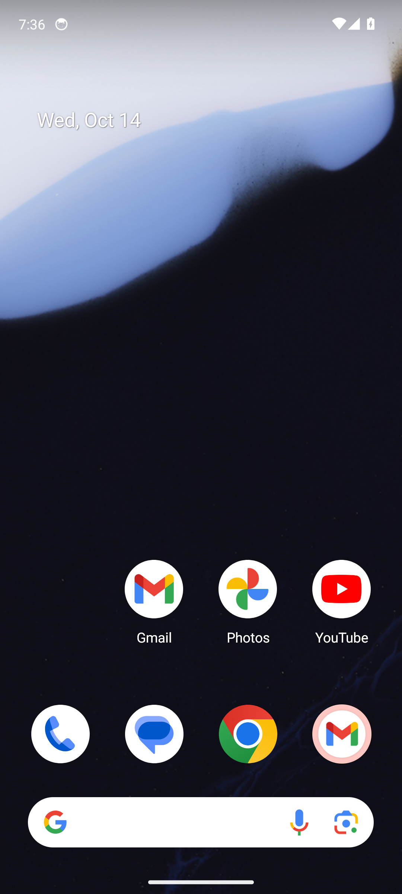
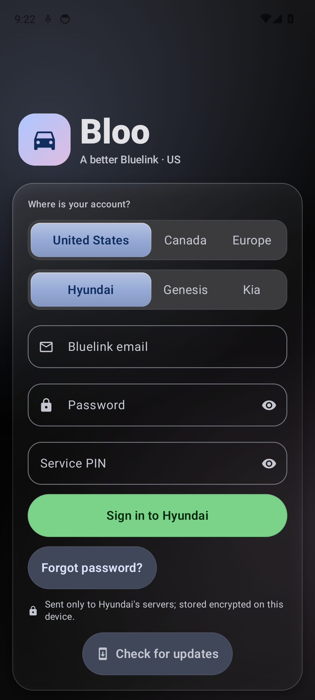

# Bloo

A third-party Android app for **Hyundai**, **Genesis** and **Kia** vehicles (US, Canada, Hyundai Europe). Built with Jetpack Compose and Material 3 Expressive for phones, foldables and tablets. Every screen talks to live servers; nothing is simulated.

| | |
| --- | --- |
|  |  |

## What it does

- **Control**: lock and unlock, remote climate, charging, live location, full vehicle status, trips, weather.
- **On-device AI**: Gemini Nano summaries and natural-language commands.
- **AutoLock**: locks the car when you walk away from it.
- **Sync**: settings and photos sync across your devices through Google Drive.
- **Layouts**: adaptive for foldables and tablets, with reorderable pebbles, custom palettes and an animated background.
- **Multiple accounts**, signed in at once.

## Security

- **One encrypted vault.** Sign-in credentials, car service PINs, session tokens and the app-lock PIN record all live in a single AES-256-GCM encrypted file. Nothing sensitive is stored anywhere else.
- **Two keys over one data key.** The vault's data key is sealed by a hardware-backed Android Keystore key, so background refresh, notifications and AutoLock keep working. If you set an app PIN, the same key is also sealed under a key derived from your PIN (PBKDF2-HMAC-SHA256, 210,000 rounds), so entering the PIN recovers your accounts if the device key is ever lost.
- **App lock.** Biometric unlock, with an optional 4 to 8 digit PIN backup, a lockout after repeated wrong PINs, and a choice of when to re-lock.
- **Nothing leaves the device** except requests to the car brand's own servers. The app collects no data.

## Install

1. Download `Bloo.apk` from the [latest release](../../releases).
2. Open it. If Play Protect warns you, choose **More details**, then **Install anyway**.

The app updates itself after that. Every push publishes a new release, and the build number is the version.

## Build

```bash
./gradlew assembleDebug
```

Needs JDK 17 and Android Studio Meerkat or newer.

## Modules

`:app` is the UI, workers and AutoLock. `:shared` holds the API clients, models and stores. `:uicommon` holds shared Compose components.

## Disclaimer

Unofficial. Not affiliated with Hyundai, Genesis or Kia. Remote commands physically operate your vehicle; use them responsibly.
