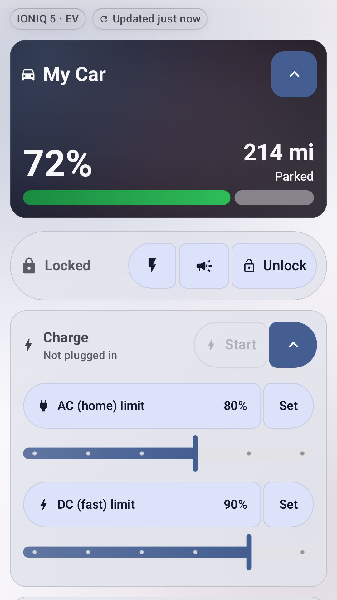
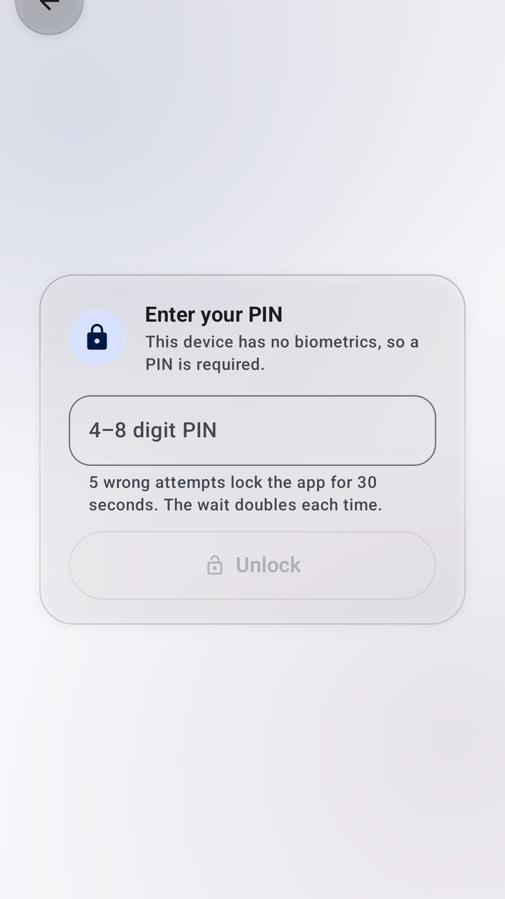
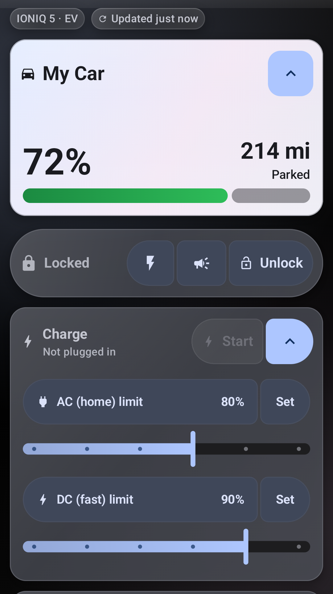
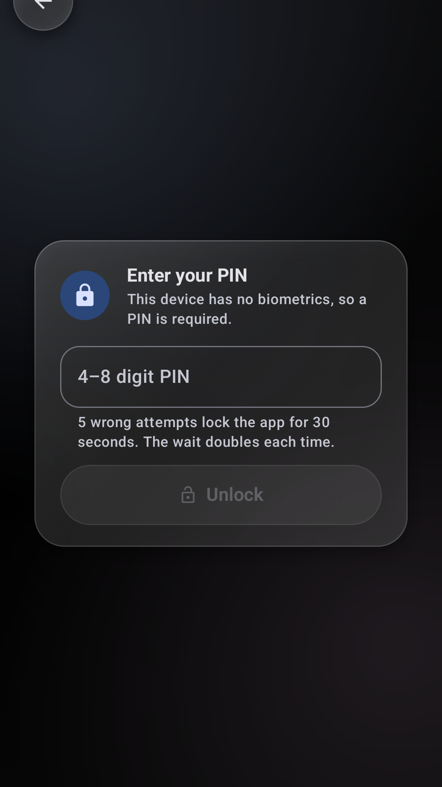

# Bloo

<p align="center">
  
</p>

<p align="center"><b>Lock, climate, charge and live status for your Hyundai, Genesis or Kia &mdash; without the slow official app.</b></p>

<p align="center">
  
  
  
  
</p>

## Get it

**On Google Play (closed test).** Access is by invitation — ask, and the Google account you use on
your phone gets added to the tester list:

**&rarr; [Join the closed test](https://play.google.com/apps/testing/com.bloo.bluelink)**

Once you're on the list, open that on the phone you want Bloo on, tap **Become a tester**, then install
from the Play Store link it gives you. Testing builds skip review, so new versions land the day they're built.

**Or install the APK directly** — see [Install](#install) below. That path needs no Play account at all.

A third-party Android app for **Hyundai**, **Genesis** and **Kia** vehicles (US, Canada, Hyundai Europe). Built with Jetpack Compose and Material 3 Expressive for phones, foldables and tablets. Every screen talks to live servers; nothing is simulated.

## What it does

- **Control**: lock and unlock, remote climate, charging, live location, full vehicle status, trips, weather.
- **On-device AI**: Gemini Nano summaries and natural-language commands.
- **AutoLock**: locks the car when you walk away from it.
- **Sync**: settings and photos sync across your devices through Google Drive.
- **Layouts**: adaptive for foldables and tablets, with reorderable pebbles, custom palettes and an animated background.
- **Multiple accounts**, signed in at once.

## Security

- **One encrypted vault.** Sign-in credentials, car service PINs, session tokens and the app-lock PIN record all live in a single AES-256-GCM encrypted file. Nothing sensitive is stored anywhere else.
- **Two keys over one data key.** The vault's data key is sealed by a hardware-backed Android Keystore key, so background refresh, notifications and AutoLock keep working. If you set an app PIN, the same key is also sealed under a key derived from your PIN (PBKDF2-HMAC-SHA256, 210,000 rounds), so entering the PIN recovers your accounts if the device key is ever lost.
- **App lock.** Biometric unlock, with an optional 4 to 8 digit PIN backup, a lockout after repeated wrong PINs, and a choice of when to re-lock.
- **Sealed after a restart.** After your phone reboots, Bloo hands out nothing and runs nothing (no alerts, AutoLock or refreshes) until you sign in with your account and then your fingerprint or PIN. A notification reminds you. You can turn this off in Settings.
- **Nothing leaves the device** except requests to the car brand's own servers. The app collects no data.

## Install

Bloo is in closed testing on Google Play (join above), or you can install it straight from a release —
no Play account and no GitHub sign-in needed.

1. On your phone, open the [latest release](https://github.com/ServerReset/Bloo/releases/latest) and, under **Assets**, download **`Bloo.apk`**. (Wear OS owners: `Bloo-watch.apk` is there too.)
2. Open the downloaded file. If you can't find it, pull down your notifications and tap the finished download, or open **Downloads** — in your browser it's usually behind the **⋮** or **☰** menu, or use the **Files** app → **Downloads**.
3. Android warns that Bloo isn't from a trusted source. What you tap depends on the warning you get:
   - **"Blocked by Play Protect" / "unsafe app"**: tap **More details** — if you don't see it, look for a **⌄** or **⋮** on the warning sheet to expand it — then **Install anyway**.
   - **"For your security…" (unknown sources)**: tap **Settings**, turn on **Allow from this source** for the app you're installing with (your browser, or Files), then go **Back** and tap **Install**.
4. Confirm with your **fingerprint, face, PIN, pattern or password**.

After that the app updates itself: every push publishes a new release, and the build number is the version.

### If an update says "App not installed"

Bloo was signed with a new key in October 2026, and Android will not install an update signed with a
different key than the copy already on your phone. A version installed before that change has to be
replaced rather than updated — the download is fine, the installer just refuses it.

Export your settings first (**Settings → Backup & sync → Export**), then uninstall Bloo, install the
newest **`Bloo.apk`** from the [releases page](https://github.com/ServerReset/Bloo/releases), sign in
again, and restore the backup. Until you do, the old copy keeps working exactly as it did — it just
stops receiving updates.

## Build

```bash
./gradlew assembleDebug
```

Needs JDK 17 and Android Studio Meerkat or newer.

## Modules

`:app` is the UI, workers and AutoLock. `:shared` holds the API clients, models and stores. `:uicommon` holds shared Compose components.

## Disclaimer

Unofficial. Not affiliated with Hyundai, Genesis or Kia. Remote commands physically operate your vehicle; use them responsibly.
